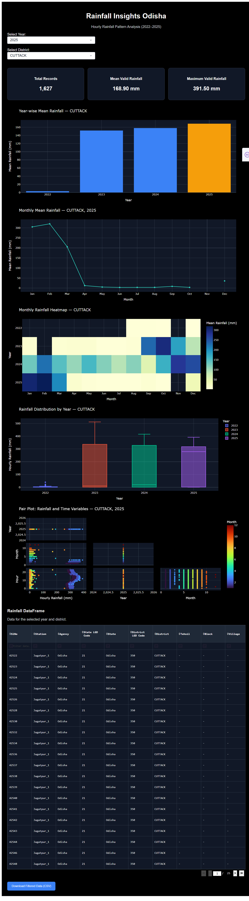

# Rainfall Insights Odisha: Hourly Rainfall Pattern Analysis (2022–2025)

## Project Overview

Rainfall Insights Odisha is a data analytics and interactive dashboard project developed to analyze hourly rainfall patterns across Odisha during 2022–2025.

The project transforms raw rainfall observations into meaningful insights using Python, Pandas, Plotly, and Dash. It allows users to explore rainfall variations across different years, months, districts, and hours through interactive visualizations.

## Dashboard



## Objectives

- Analyze hourly rainfall patterns across Odisha.
- Compare rainfall variations across different years.
- Study monthly and hourly rainfall patterns.
- Compare rainfall observations across districts.
- Identify unusual or invalid rainfall readings.
- Present the analysis through an interactive dashboard.

## Dataset

The dataset contains hourly telemetry rainfall observations from rainfall monitoring stations in Odisha.

### Main Features

- Station
- District
- Data Acquisition Time
- Telemetry Hourly Rainfall (mm)
- SlNo
- Year
- Month
- Hour

The analysis focuses on rainfall observations from **2022 to 2025**.

## Data Preprocessing

The following preprocessing steps were performed:

- Removed duplicate records.
- Handled missing values.
- Converted date and time into datetime format.
- Converted rainfall values into numeric format.
- Identified invalid negative rainfall readings.
- Excluded negative rainfall values from valid rainfall calculations.
- Created Year, Month, and Hour features for analysis.

## Exploratory Data Analysis

The project uses different visualization techniques to understand rainfall patterns:

- Year-wise rainfall comparison
- Monthly rainfall trends
- Monthly-year heatmap
- Rainfall distribution using box plots
- Multivariate analysis using pair plots
- District and time-based filtering

## Dashboard Features

The interactive Dash dashboard provides:

- Year filter
- District filter
- Total Records KPI
- Mean Valid Rainfall KPI
- Maximum Valid Rainfall KPI
- Year-wise rainfall bar chart
- Monthly rainfall trend
- Monthly-year heatmap
- Rainfall distribution box plot
- Pair plot/scatter analysis
- Filtered rainfall data table
- CSV download option

## Technologies Used

- Python
- Pandas
- Plotly
- Dash
- Jupyter Notebook

## Project Structure

```text
Rainfall-Insights-Odisha/
│
├── app.py
├── python.ipynb
├── rainfall_tel_hr_odisha_od_2021_2025.csv
├── dashboard.png
├── requirements.txt
└── .gitignore
